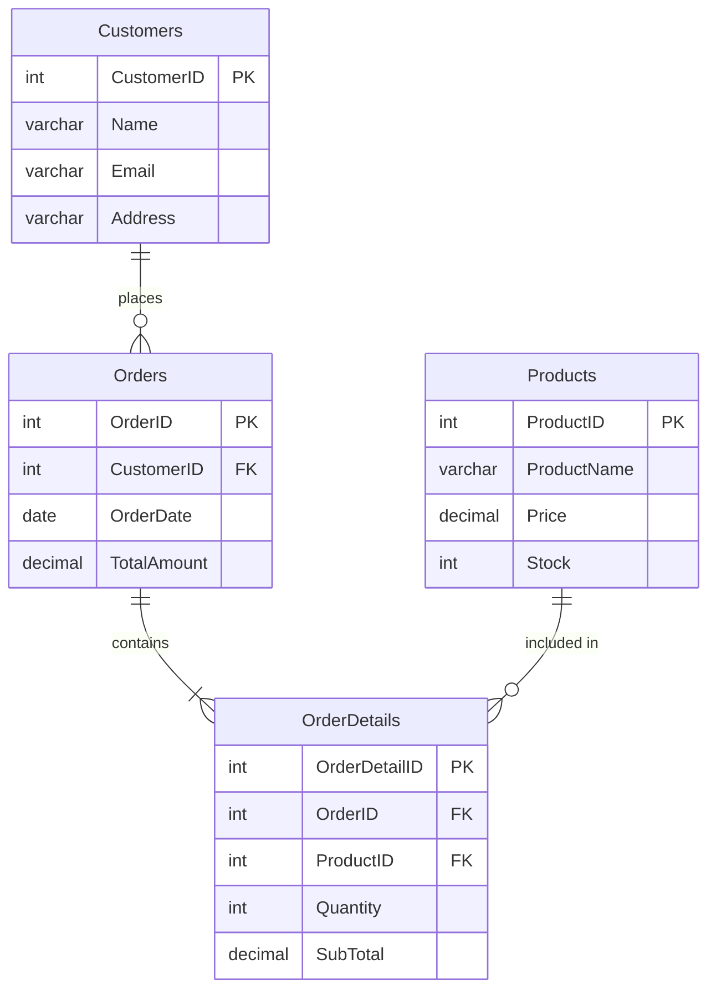
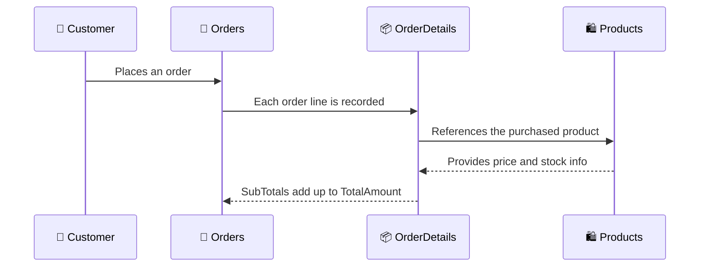
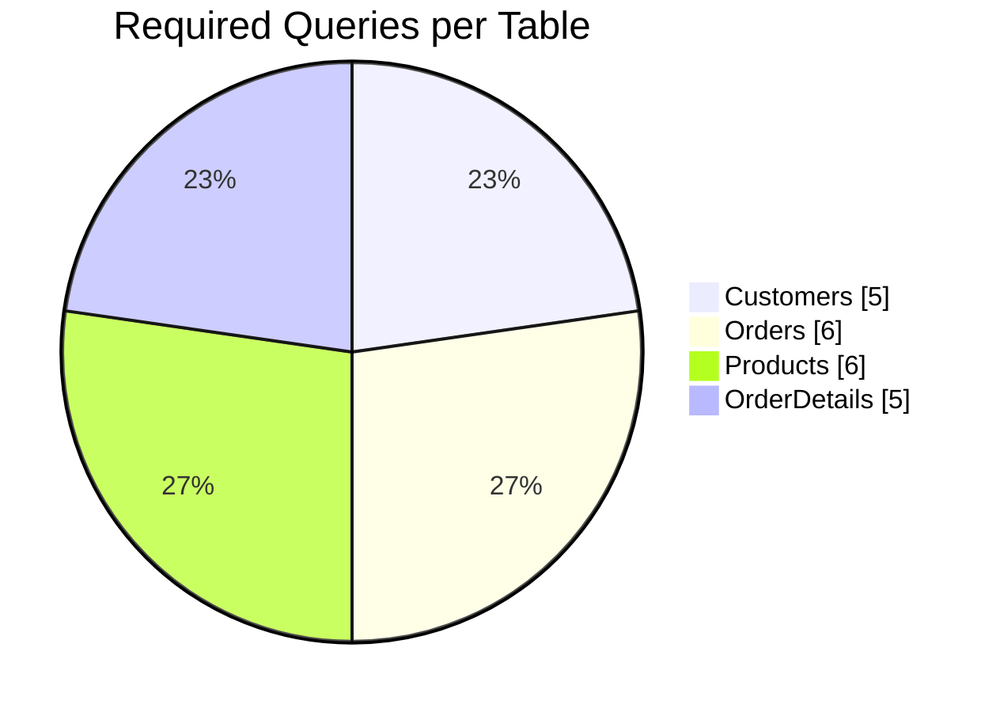
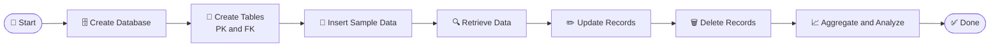

<div align="center">


<a href="https://git.io/typing-svg">
  
</a>

<br/><br/>


<br/>


</div>

## 📖 Table of Contents

| # | Section | # | Section |
|---|---------|---|---------|
| 1 | [📌 Project Overview](#overview) | 9 | [🧪 Sample Data](#data) |
| 2 | [🎥 Video Demo](#demo) | 10 | [🔍 All Queries with Output](#queries) |
| 3 | [🎯 Learning Outcomes](#outcomes) | 11 | [🎁 Bonus Practice Queries](#bonus) |
| 4 | [🛠️ Tech Stack](#tech) | 12 | [💡 SQL Concepts Explained](#concepts) |
| 5 | [🗂️ Database Design](#design) | 13 | [📁 Project Structure](#structure) |
| 6 | [🚀 Getting Started](#setup) | 14 | [🩺 Troubleshooting](#troubleshooting) |
| 7 | [🧱 Table Creation (DDL)](#ddl) | 15 | [🔮 Future Enhancements](#future) |
| 8 | [📊 Project at a Glance](#glance) | 16 | [👨‍💻 About the Author](#author) |


<a id="overview"></a>
## 📌 Project Overview

**Data Digger** is a practical SQL project that provides hands-on experience in managing a **MySQL** database using **CRUD operations, clauses, operators, aggregate functions, primary keys, and foreign keys**.

In this project, a structured **relational database for an E-Commerce Store** is designed and manipulated from scratch, giving deeper insight into how SQL queries are written, executed, and optimized in a real-world scenario.

### ✨ What makes this project special?

| 🔹 Feature | 📝 Description |
|-----------|---------------|
| **Real-world scenario** | Models an actual online store with customers, orders, products, and order line items |
| **Complete CRUD coverage** | Every table has Create, Read, Update, and Delete operations |
| **Relational integrity** | Uses primary keys and foreign keys to connect all four tables |
| **Analytical queries** | Aggregate functions (`MAX`, `MIN`, `AVG`, `SUM`, `COUNT`) for business insights |
| **Date-based filtering** | Dynamic queries that use `CURDATE()` so results always stay relevant |
| **Beginner friendly** | Every query is commented, organized, and has expected output |

---

<a id="demo"></a>
## 🎥 Video Demo

<div align="center">


[](https://drive.google.com/file/d/1H3dd6OZ-kHdqWSBJuk4gbiCzAq9g4UKD/view?usp=sharing)

<!-- OPTIONAL: Use a clickable thumbnail instead of the button above.
[](YOUR_VIDEO_DEMO_LINK_HERE)
-->

**📺 Video Link:

</div>

---

<a id="outcomes"></a>
## 🎯 Learning Outcomes

After completing this project, you will be able to:

- [x] Design a relational database with **four connected tables**
- [x] Define **primary keys** to uniquely identify every record
- [x] Use **foreign keys** to maintain referential integrity between tables
- [x] Perform **INSERT, SELECT, UPDATE, and DELETE** operations confidently
- [x] Filter data with **WHERE**, **BETWEEN**, and comparison operators
- [x] Sort and limit results with **ORDER BY** and **LIMIT**
- [x] Summarize data with **MAX(), MIN(), AVG(), SUM(), COUNT()**
- [x] Group data with **GROUP BY** and combine tables with **JOIN**
- [x] Work with **dates** using `CURDATE()` and `DATE_SUB()`
- [x] Debug common MySQL errors such as foreign key and safe-update errors

---

<a id="tech"></a>
## 🛠️ Tech Stack

<div align="center">


</div>

| Technology | Purpose |
|------------|---------|
| 🐬 **MySQL 8.x** | Relational database management system |
| 📜 **SQL** | Querying and manipulating data |
| 🖥️ **MySQL Workbench / CLI** | Writing, running, and testing queries |
| 🌿 **Git and GitHub** | Version control and project hosting |
| 📝 **Markdown + Mermaid** | Documentation and diagrams |

---

<a id="design"></a>
## 🗂️ Database Design

### 🧩 Entity Relationship Diagram



### 🔗 Relationships

| From | To | Type | Linked By |
|------|----|------|-----------|
| `Customers` | `Orders` | One-to-Many | `Orders.CustomerID` → `Customers.CustomerID` |
| `Orders` | `OrderDetails` | One-to-Many | `OrderDetails.OrderID` → `Orders.OrderID` |
| `Products` | `OrderDetails` | One-to-Many | `OrderDetails.ProductID` → `Products.ProductID` |
| `Orders` | `Products` | Many-to-Many | Resolved through the `OrderDetails` table |

### 🔄 How Data Flows Through the Store



### 📚 Data Dictionary

#### 1️⃣ Customers

| Column | Data Type | Constraints | Description |
|--------|-----------|-------------|-------------|
| `CustomerID` | `INT` | 🔑 PRIMARY KEY, AUTO_INCREMENT | Unique ID of each customer |
| `Name` | `VARCHAR(100)` | NOT NULL | Customer's full name |
| `Email` | `VARCHAR(150)` | NOT NULL, UNIQUE | Customer's email address |
| `Address` | `VARCHAR(255)` | — | Customer's delivery address |

#### 2️⃣ Orders

| Column | Data Type | Constraints | Description |
|--------|-----------|-------------|-------------|
| `OrderID` | `INT` | 🔑 PRIMARY KEY, AUTO_INCREMENT | Unique ID of each order |
| `CustomerID` | `INT` | 🔗 FOREIGN KEY → `Customers`, NOT NULL | Customer who placed the order |
| `OrderDate` | `DATE` | NOT NULL | Date the order was placed |
| `TotalAmount` | `DECIMAL(10,2)` | NOT NULL | Total value of the order (₹) |

#### 3️⃣ Products

| Column | Data Type | Constraints | Description |
|--------|-----------|-------------|-------------|
| `ProductID` | `INT` | 🔑 PRIMARY KEY, AUTO_INCREMENT | Unique ID of each product |
| `ProductName` | `VARCHAR(150)` | NOT NULL | Name of the product |
| `Price` | `DECIMAL(10,2)` | NOT NULL | Price per unit (₹) |
| `Stock` | `INT` | NOT NULL, DEFAULT 0 | Units currently available |

#### 4️⃣ OrderDetails

| Column | Data Type | Constraints | Description |
|--------|-----------|-------------|-------------|
| `OrderDetailID` | `INT` | 🔑 PRIMARY KEY, AUTO_INCREMENT | Unique ID of each order line |
| `OrderID` | `INT` | 🔗 FOREIGN KEY → `Orders`, NOT NULL | Order this line belongs to |
| `ProductID` | `INT` | 🔗 FOREIGN KEY → `Products`, NOT NULL | Product that was purchased |
| `Quantity` | `INT` | NOT NULL | Number of units purchased |
| `SubTotal` | `DECIMAL(10,2)` | NOT NULL | `Quantity × Price` for this line (₹) |

---

<a id="setup"></a>
## 🚀 Getting Started

### 📋 Prerequisites

- ✅ **MySQL Server 8.0+** installed and running
- ✅ **MySQL Workbench** (recommended) or the MySQL command-line client
- ✅ **Git** (optional, for cloning the repository)

### ⚙️ Installation and Execution

**Step 1: Clone the repository**

```bash
git clone https://github.com/YOUR_USERNAME/data-digger.git
cd data-digger
```

**Step 2: Run the SQL script**

*Option A: MySQL command line*

```bash
mysql -u root -p < data_digger.sql
```

*Option B: MySQL Workbench*

1. Open **MySQL Workbench** and connect to your local server
2. Go to **File → Open SQL Script** and select `data_digger.sql`
3. Click the ⚡ **Execute** button (or press `Ctrl + Shift + Enter`)

**Step 3: Verify the setup**

```sql
USE DataDigger;
SHOW TABLES;
```

You should see:

```
+----------------------+
| Tables_in_datadigger |
+----------------------+
| Customers            |
| OrderDetails         |
| Orders               |
| Products             |
+----------------------+
```

> 💡 **Tip:** Run the script from top to bottom. The delete queries target rows that have no linked records, so the foreign key constraints will not block them.

> 🔁 **Re-running the script?** Start fresh with `DROP DATABASE IF EXISTS DataDigger;` first.

---

<a id="ddl"></a>
## 🧱 Table Creation (DDL)

<details>
<summary><b>👉 Click to expand the CREATE statements</b></summary>

```sql
CREATE DATABASE IF NOT EXISTS DataDigger;
USE DataDigger;

CREATE TABLE Customers (
    CustomerID INT AUTO_INCREMENT PRIMARY KEY,
    Name       VARCHAR(100) NOT NULL,
    Email      VARCHAR(150) NOT NULL UNIQUE,
    Address    VARCHAR(255)
);

CREATE TABLE Products (
    ProductID   INT AUTO_INCREMENT PRIMARY KEY,
    ProductName VARCHAR(150) NOT NULL,
    Price       DECIMAL(10,2) NOT NULL,
    Stock       INT NOT NULL DEFAULT 0
);

CREATE TABLE Orders (
    OrderID     INT AUTO_INCREMENT PRIMARY KEY,
    CustomerID  INT NOT NULL,
    OrderDate   DATE NOT NULL,
    TotalAmount DECIMAL(10,2) NOT NULL,
    FOREIGN KEY (CustomerID) REFERENCES Customers(CustomerID)
);

CREATE TABLE OrderDetails (
    OrderDetailID INT AUTO_INCREMENT PRIMARY KEY,
    OrderID       INT NOT NULL,
    ProductID     INT NOT NULL,
    Quantity      INT NOT NULL,
    SubTotal      DECIMAL(10,2) NOT NULL,
    FOREIGN KEY (OrderID)   REFERENCES Orders(OrderID),
    FOREIGN KEY (ProductID) REFERENCES Products(ProductID)
);
```

</details>

---

<a id="glance"></a>
## 📊 Project at a Glance

<div align="center">

| 🗃️ Tables | 🔑 Primary Keys | 🔗 Foreign Keys | 📝 Required Queries | 🧪 Sample Rows |
|:---------:|:--------------:|:---------------:|:-------------------:|:--------------:|
| **4** | **4** | **3** | **22** | **25** |

</div>

### 🥧 Query Distribution



### 🧭 Project Workflow



### ✅ Completion Tracker

```
Customers      ██████████████████████ 100%  (5/5 queries)
Orders         ██████████████████████ 100%  (6/6 queries)
Products       ██████████████████████ 100%  (6/6 queries)
OrderDetails   ██████████████████████ 100%  (5/5 queries)
```

---

<a id="data"></a>
## 🧪 Sample Data

> 📅 Order dates use `CURDATE()` so the "last 30 days" query always returns meaningful results.

<details>
<summary><b>👤 Customers (6 rows)</b></summary>

| CustomerID | Name | Email | Address |
|:----------:|------|-------|---------|
| 1 | Alice | alice@example.com | 12 Ring Road, Surat |
| 2 | Bob | bob@example.com | 45 MG Road, Mumbai |
| 3 | Charlie | charlie@example.com | 78 Park Street, Kolkata |
| 4 | David | david@example.com | 23 Anna Salai, Chennai |
| 5 | Eva | eva@example.com | 9 Civil Lines, Delhi |
| 6 | Frank | frank@example.com | 56 FC Road, Pune |

</details>

<details>
<summary><b>🧾 Orders (6 rows)</b></summary>

| OrderID | CustomerID | OrderDate | TotalAmount |
|:-------:|:----------:|-----------|------------:|
| 1 | 1 | `CURDATE() - 5 days` | 2845.00 |
| 2 | 2 | `CURDATE() - 12 days` | 2499.00 |
| 3 | 1 | `CURDATE() - 20 days` | 2498.00 |
| 4 | 3 | `CURDATE() - 28 days` | 2598.00 |
| 5 | 4 | `CURDATE() - 45 days` | 1700.00 |
| 6 | 5 | `CURDATE() - 60 days` | 1200.00 |

</details>

<details>
<summary><b>🛍️ Products (6 rows)</b></summary>

| ProductID | ProductName | Price (₹) | Stock |
|:---------:|-------------|----------:|------:|
| 1 | Wireless Mouse | 799.00 | 50 |
| 2 | Mechanical Keyboard | 2499.00 | 30 |
| 3 | USB-C Cable | 349.00 | 100 |
| 4 | Bluetooth Headphones | 1599.00 | 25 |
| 5 | Laptop Stand | 1299.00 | 40 |
| 6 | Phone Case | 299.00 | 0 |

</details>

<details>
<summary><b>📦 OrderDetails (7 rows)</b></summary>

| OrderDetailID | OrderID | ProductID | Quantity | SubTotal (₹) |
|:-------------:|:-------:|:---------:|:--------:|-------------:|
| 1 | 1 | 1 | 2 | 1798.00 |
| 2 | 1 | 3 | 3 | 1047.00 |
| 3 | 2 | 2 | 1 | 2499.00 |
| 4 | 3 | 4 | 1 | 1599.00 |
| 5 | 3 | 1 | 1 | 899.00 |
| 6 | 4 | 5 | 2 | 2598.00 |
| 7 | 5 | 3 | 5 | 1745.00 |

</details>

---

<a id="queries"></a>
## 🔍 All Queries with Output

> 📌 Outputs below are shown in the order the script runs. Click **Expected Output** under each query to expand it.


### 1️⃣ Customers Table

#### ✅ 1.1 Insert at least 5 sample customers

```sql
INSERT INTO Customers (CustomerID, Name, Email, Address) VALUES
(1, 'Alice',   'alice@example.com',   '12 Ring Road, Surat'),
(2, 'Bob',     'bob@example.com',     '45 MG Road, Mumbai'),
(3, 'Charlie', 'charlie@example.com', '78 Park Street, Kolkata'),
(4, 'David',   'david@example.com',   '23 Anna Salai, Chennai'),
(5, 'Eva',     'eva@example.com',     '9 Civil Lines, Delhi'),
(6, 'Frank',   'frank@example.com',   '56 FC Road, Pune');
```

#### ✅ 1.2 Retrieve all customer details

```sql
SELECT * FROM Customers;
```

<details>
<summary><b>📤 Expected Output</b></summary>

| CustomerID | Name | Email | Address |
|:----------:|------|-------|---------|
| 1 | Alice | alice@example.com | 12 Ring Road, Surat |
| 2 | Bob | bob@example.com | 45 MG Road, Mumbai |
| 3 | Charlie | charlie@example.com | 78 Park Street, Kolkata |
| 4 | David | david@example.com | 23 Anna Salai, Chennai |
| 5 | Eva | eva@example.com | 9 Civil Lines, Delhi |
| 6 | Frank | frank@example.com | 56 FC Road, Pune |

</details>

#### ✅ 1.3 Update a customer's address

```sql
UPDATE Customers
SET Address = '101 Athwa Lines, Surat'
WHERE CustomerID = 1;
```

> 💬 *Result:* `1 row(s) affected`

#### ✅ 1.4 Delete a customer using their CustomerID

```sql
DELETE FROM Customers
WHERE CustomerID = 6;
```

> 💬 *Result:* `1 row(s) affected`. Customer 6 (Frank) has no orders, so the foreign key does not block this delete.

#### ✅ 1.5 Display all customers whose name is 'Alice'

```sql
SELECT * FROM Customers
WHERE Name = 'Alice';
```

<details>
<summary><b>📤 Expected Output</b></summary>

| CustomerID | Name | Email | Address |
|:----------:|------|-------|---------|
| 1 | Alice | alice@example.com | 101 Athwa Lines, Surat |

</details>


### 2️⃣ Orders Table

#### ✅ 2.1 Insert at least 5 sample orders

```sql
INSERT INTO Orders (OrderID, CustomerID, OrderDate, TotalAmount) VALUES
(1, 1, DATE_SUB(CURDATE(), INTERVAL 5  DAY), 2845.00),
(2, 2, DATE_SUB(CURDATE(), INTERVAL 12 DAY), 2499.00),
(3, 1, DATE_SUB(CURDATE(), INTERVAL 20 DAY), 2498.00),
(4, 3, DATE_SUB(CURDATE(), INTERVAL 28 DAY), 2598.00),
(5, 4, DATE_SUB(CURDATE(), INTERVAL 45 DAY), 1700.00),
(6, 5, DATE_SUB(CURDATE(), INTERVAL 60 DAY), 1200.00);
```

#### ✅ 2.2 Retrieve all orders made by a specific customer

```sql
SELECT * FROM Orders
WHERE CustomerID = 1;
```

<details>
<summary><b>📤 Expected Output</b></summary>

| OrderID | CustomerID | OrderDate | TotalAmount |
|:-------:|:----------:|-----------|------------:|
| 1 | 1 | `CURDATE() - 5 days` | 2845.00 |
| 3 | 1 | `CURDATE() - 20 days` | 2498.00 |

</details>

#### ✅ 2.3 Update an order's total amount

```sql
UPDATE Orders
SET TotalAmount = 1745.00
WHERE OrderID = 5;
```

> 💬 *Result:* `1 row(s) affected`

#### ✅ 2.4 Delete an order using its OrderID

```sql
DELETE FROM Orders
WHERE OrderID = 6;
```

> 💬 *Result:* `1 row(s) affected`

#### ✅ 2.5 Retrieve orders placed in the last 30 days

```sql
SELECT * FROM Orders
WHERE OrderDate >= DATE_SUB(CURDATE(), INTERVAL 30 DAY);
```

<details>
<summary><b>📤 Expected Output</b></summary>

| OrderID | CustomerID | OrderDate | TotalAmount |
|:-------:|:----------:|-----------|------------:|
| 1 | 1 | `CURDATE() - 5 days` | 2845.00 |
| 2 | 2 | `CURDATE() - 12 days` | 2499.00 |
| 3 | 1 | `CURDATE() - 20 days` | 2498.00 |
| 4 | 3 | `CURDATE() - 28 days` | 2598.00 |

</details>

#### ✅ 2.6 Retrieve the highest, lowest, and average order amount (aggregate functions)

```sql
SELECT
    MAX(TotalAmount) AS HighestOrderAmount,
    MIN(TotalAmount) AS LowestOrderAmount,
    AVG(TotalAmount) AS AverageOrderAmount
FROM Orders;
```

<details>
<summary><b>📤 Expected Output</b></summary>

| HighestOrderAmount | LowestOrderAmount | AverageOrderAmount |
|-------------------:|------------------:|-------------------:|
| 2845.00 | 1745.00 | 2437.000000 |

</details>


### 3️⃣ Products Table

#### ✅ 3.1 Insert at least 5 sample products

```sql
INSERT INTO Products (ProductID, ProductName, Price, Stock) VALUES
(1, 'Wireless Mouse',        799.00,  50),
(2, 'Mechanical Keyboard',  2499.00,  30),
(3, 'USB-C Cable',           349.00, 100),
(4, 'Bluetooth Headphones', 1599.00,  25),
(5, 'Laptop Stand',         1299.00,  40),
(6, 'Phone Case',            299.00,   0);
```

#### ✅ 3.2 Retrieve all products sorted by price in descending order

```sql
SELECT * FROM Products
ORDER BY Price DESC;
```

<details>
<summary><b>📤 Expected Output</b></summary>

| ProductID | ProductName | Price | Stock |
|:---------:|-------------|------:|------:|
| 2 | Mechanical Keyboard | 2499.00 | 30 |
| 4 | Bluetooth Headphones | 1599.00 | 25 |
| 5 | Laptop Stand | 1299.00 | 40 |
| 1 | Wireless Mouse | 799.00 | 50 |
| 3 | USB-C Cable | 349.00 | 100 |
| 6 | Phone Case | 299.00 | 0 |

</details>

#### ✅ 3.3 Update the price of a specific product

```sql
UPDATE Products
SET Price = 899.00
WHERE ProductID = 1;
```

> 💬 *Result:* `1 row(s) affected`

#### ✅ 3.4 Delete a product if it's out of stock

```sql
SET SQL_SAFE_UPDATES = 0;   -- needed in MySQL Workbench (non-key WHERE condition)
DELETE FROM Products
WHERE Stock = 0;
SET SQL_SAFE_UPDATES = 1;
```

> 💬 *Result:* `1 row(s) affected`. The out-of-stock product (Phone Case) is removed.

#### ✅ 3.5 Retrieve products whose price is between ₹500 and ₹2000

```sql
SELECT * FROM Products
WHERE Price BETWEEN 500 AND 2000;
```

<details>
<summary><b>📤 Expected Output</b></summary>

| ProductID | ProductName | Price | Stock |
|:---------:|-------------|------:|------:|
| 1 | Wireless Mouse | 899.00 | 50 |
| 4 | Bluetooth Headphones | 1599.00 | 25 |
| 5 | Laptop Stand | 1299.00 | 40 |

</details>

#### ✅ 3.6 Retrieve the most expensive and cheapest product using MAX() and MIN()

```sql
SELECT
    MAX(Price) AS MostExpensivePrice,
    MIN(Price) AS CheapestPrice
FROM Products;
```

<details>
<summary><b>📤 Expected Output</b></summary>

| MostExpensivePrice | CheapestPrice |
|-------------------:|--------------:|
| 2499.00 | 349.00 |

</details>

**🔎 Same query, now showing the product names:**

```sql
SELECT ProductID, ProductName, Price
FROM Products
WHERE Price = (SELECT MAX(Price) FROM Products)
   OR Price = (SELECT MIN(Price) FROM Products);
```

<details>
<summary><b>📤 Expected Output</b></summary>

| ProductID | ProductName | Price |
|:---------:|-------------|------:|
| 2 | Mechanical Keyboard | 2499.00 |
| 3 | USB-C Cable | 349.00 |

</details>


### 4️⃣ OrderDetails Table

#### ✅ 4.1 Insert at least 5 sample records

```sql
INSERT INTO OrderDetails (OrderDetailID, OrderID, ProductID, Quantity, SubTotal) VALUES
(1, 1, 1, 2, 1798.00),
(2, 1, 3, 3, 1047.00),
(3, 2, 2, 1, 2499.00),
(4, 3, 4, 1, 1599.00),
(5, 3, 1, 1,  899.00),
(6, 4, 5, 2, 2598.00),
(7, 5, 3, 5, 1745.00);
```

#### ✅ 4.2 Retrieve all order details for a specific order

```sql
SELECT * FROM OrderDetails
WHERE OrderID = 1;
```

<details>
<summary><b>📤 Expected Output</b></summary>

| OrderDetailID | OrderID | ProductID | Quantity | SubTotal |
|:-------------:|:-------:|:---------:|:--------:|---------:|
| 1 | 1 | 1 | 2 | 1798.00 |
| 2 | 1 | 3 | 3 | 1047.00 |

</details>

#### ✅ 4.3 Calculate the total revenue generated from all orders using SUM()

```sql
SELECT SUM(SubTotal) AS TotalRevenue
FROM OrderDetails;
```

<details>
<summary><b>📤 Expected Output</b></summary>

| TotalRevenue |
|-------------:|
| 12185.00 |

</details>

#### ✅ 4.4 Retrieve the top 3 most ordered products

```sql
SELECT
    od.ProductID,
    p.ProductName,
    SUM(od.Quantity) AS TotalQuantityOrdered
FROM OrderDetails od
JOIN Products p ON od.ProductID = p.ProductID
GROUP BY od.ProductID, p.ProductName
ORDER BY TotalQuantityOrdered DESC
LIMIT 3;
```

<details>
<summary><b>📤 Expected Output</b></summary>

| ProductID | ProductName | TotalQuantityOrdered |
|:---------:|-------------|---------------------:|
| 3 | USB-C Cable | 8 |
| 1 | Wireless Mouse | 3 |
| 5 | Laptop Stand | 2 |

</details>

#### ✅ 4.5 Count how many times a specific product has been sold using COUNT()

```sql
SELECT COUNT(*) AS TimesSold
FROM OrderDetails
WHERE ProductID = 3;
```

<details>
<summary><b>📤 Expected Output</b></summary>

| TimesSold |
|----------:|
| 2 |

</details>

---

<a id="bonus"></a>
## 🎁 Bonus Practice Queries

> 🧠 These are **extra** queries (not part of the original task) to help you practice JOINs, GROUP BY, HAVING, and LIKE.

<details>
<summary><b>🔗 1. Customer order history (JOIN)</b></summary>

```sql
SELECT c.Name, o.OrderID, o.OrderDate, o.TotalAmount
FROM Customers c
JOIN Orders o ON c.CustomerID = o.CustomerID
ORDER BY o.OrderDate DESC;
```

</details>

<details>
<summary><b>💰 2. Total spending per customer (GROUP BY)</b></summary>

```sql
SELECT c.Name, SUM(o.TotalAmount) AS TotalSpent
FROM Customers c
JOIN Orders o ON c.CustomerID = o.CustomerID
GROUP BY c.CustomerID, c.Name
ORDER BY TotalSpent DESC;
```

</details>

<details>
<summary><b>🔁 3. Customers with more than one order (HAVING)</b></summary>

```sql
SELECT c.Name, COUNT(o.OrderID) AS TotalOrders
FROM Customers c
JOIN Orders o ON c.CustomerID = o.CustomerID
GROUP BY c.CustomerID, c.Name
HAVING COUNT(o.OrderID) > 1;
```

</details>

<details>
<summary><b>🔤 4. Customers whose name starts with 'A' (LIKE)</b></summary>

```sql
SELECT * FROM Customers
WHERE Name LIKE 'A%';
```

</details>

<details>
<summary><b>🧾 5. Full invoice for an order (multi-table JOIN)</b></summary>

```sql
SELECT o.OrderID, c.Name AS Customer, p.ProductName,
       od.Quantity, p.Price, od.SubTotal
FROM Orders o
JOIN Customers c     ON o.CustomerID = c.CustomerID
JOIN OrderDetails od ON o.OrderID = od.OrderID
JOIN Products p      ON od.ProductID = p.ProductID
WHERE o.OrderID = 1;
```

</details>

<details>
<summary><b>📉 6. Low stock alert</b></summary>

```sql
SELECT ProductName, Stock
FROM Products
WHERE Stock < 30
ORDER BY Stock ASC;
```

</details>

---

<a id="concepts"></a>
## 💡 SQL Concepts Explained

| Concept | What it does | Where it is used |
|---------|--------------|------------------|
| **CRUD** | Create (`INSERT`), Read (`SELECT`), Update (`UPDATE`), Delete (`DELETE`) | All four tables |
| **Primary Key** | Uniquely identifies every row in a table | `CustomerID`, `OrderID`, `ProductID`, `OrderDetailID` |
| **Foreign Key** | Links a column to another table's primary key and keeps data consistent | `Orders.CustomerID`, `OrderDetails.OrderID`, `OrderDetails.ProductID` |
| **WHERE** | Filters rows that match a condition | Customers, Orders, Products, OrderDetails |
| **ORDER BY** | Sorts the result set (`ASC` / `DESC`) | Products (price descending) |
| **BETWEEN** | Checks if a value lies within a range | Products (₹500 to ₹2000) |
| **Comparison operators** | `=`, `>=`, `<`, `>` compare values | Orders (last 30 days) |
| **GROUP BY** | Groups rows so aggregates can be calculated per group | Top 3 most ordered products |
| **LIMIT** | Restricts the number of rows returned | Top 3 products |
| **JOIN** | Combines rows from two or more tables | Top 3 products, bonus queries |
| **MAX() / MIN()** | Returns the largest / smallest value | Orders, Products |
| **AVG()** | Returns the average value | Orders |
| **SUM()** | Returns the total of a numeric column | OrderDetails (total revenue) |
| **COUNT()** | Counts the number of rows | OrderDetails (times a product sold) |
| **CURDATE() / DATE_SUB()** | Work with the current date and subtract time intervals | Orders (last 30 days) |

---

<a id="structure"></a>
## 📁 Project Structure

```
📦 data-digger
 ┣ 📜 data_digger.sql     # Database, tables, sample data, and all 22 queries
 ┗ 📜 README.md           # Project documentation (you are here)
```

---

<a id="troubleshooting"></a>
## 🩺 Troubleshooting

<details>
<summary><b>❌ Error 1175: You are using safe update mode</b></summary>

MySQL Workbench blocks `UPDATE` / `DELETE` statements that do not use a key column in `WHERE`.

```sql
SET SQL_SAFE_UPDATES = 0;
-- run your query here
SET SQL_SAFE_UPDATES = 1;
```

</details>

<details>
<summary><b>❌ Error 1451: Cannot delete or update a parent row</b></summary>

A foreign key is blocking the delete because child rows still exist. Delete the child rows first (for example `OrderDetails` before `Orders`), or delete a record that has no linked data.

</details>

<details>
<summary><b>❌ Error 1452: Cannot add or update a child row</b></summary>

You are inserting a foreign key value that does not exist in the parent table. Insert the parent row first (`Customers` → `Orders` → `OrderDetails`).

</details>

<details>
<summary><b>❌ Error 1062: Duplicate entry</b></summary>

The data already exists (for example after running the script twice). Reset the database and run it again:

```sql
DROP DATABASE IF EXISTS DataDigger;
```

</details>

<details>
<summary><b>❌ Error 1046: No database selected</b></summary>

Select the database before running queries:

```sql
USE DataDigger;
```

</details>

---

<a id="future"></a>
## 🔮 Future Enhancements

- [ ] Add `ON DELETE CASCADE` rules for automatic cleanup of related rows
- [ ] Create **indexes** to speed up frequent searches
- [ ] Add **views** for monthly sales reports
- [ ] Write **stored procedures** for placing an order
- [ ] Add **triggers** to reduce product stock automatically after an order
- [ ] Add a `Categories` table and a `Reviews` table
- [ ] Connect the database to a **Node.js / React** front end

---

<a id="author"></a>
<div align="center">

## 👨‍💻 About the Author

<a href="https://git.io/typing-svg">
  
</a>

### **Nihar Sheladiya**

*"Quality is our Motto."*
**Shaping "skills" for "scaling" higher...!!!**

<br/>

[](https://github.com/YOUR_USERNAME)
[](https://www.linkedin.com/in/YOUR_PROFILE)
[](mailto:YOUR_EMAIL@example.com)

<br/>


### 🙏 Thank you for visiting!

⭐ **If you found this project helpful, please give it a star!** ⭐

<br/>


<br/><br/>


</div>
